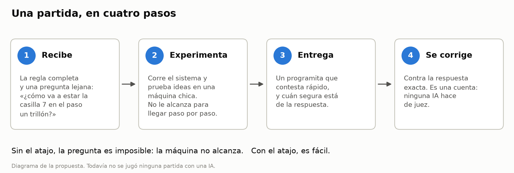
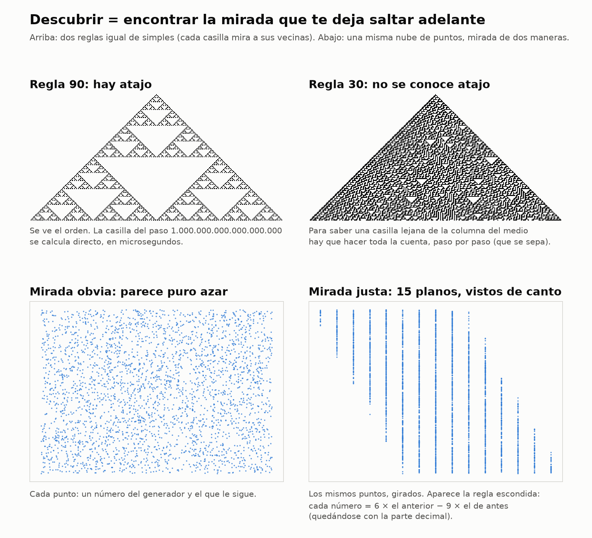
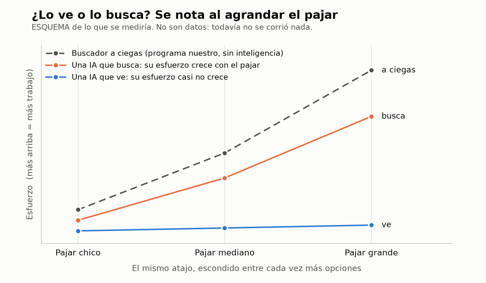

# Guía de los atajos

> Copia pública de la guía. Lucas la edita y comenta en un Claude Doc privado; este archivo se actualiza
> desde ahí (última copia: 15-nov-2026). El detalle y las críticas están en la
> [propuesta](../research/proposals/2026-11-15-discovery-as-finding-a-shortcut.md).

**Es una propuesta en diseño. Todavía no se corrió nada con una IA.**

Esta guía cuenta qué queremos investigar, paso a paso y sin jerga. Cada paso prepara el siguiente: conviene leerla en orden. Al final están las fuentes, de dónde sale cada idea y quién hizo algo parecido.

## 1. Dos maneras de abrir un candado

Imaginá un candado de tres números. No sabés la clave.

Una manera de abrirlo es probar: 000, 001, 002... Son mil combinaciones. Tarde o temprano, abre.

La otra manera es mirar el candado. Ves que tres de las ruedas están más gastadas en un número. Probás ese, y abre a la primera.

Las dos personas abrieron el candado. Si solo mirás el resultado, son iguales. Pero pasó algo muy distinto. Una **buscó**: recorrió las opciones hasta dar con la buena. La otra **vio** algo que le ahorró recorrerlas.

La diferencia aparece cuando el candado tiene diez números en vez de tres. Al que busca le tocan diez mil millones de combinaciones: no termina nunca. Al que ve, le da lo mismo.

**Llegar a la respuesta no dice cómo llegaste.**

## 2. La misma duda, con una IA

Ahora cambiá a la persona por una IA. Le das un problema difícil y lo resuelve. Queda la misma duda: ¿vio algo, o probó hasta que salió?

Con una IA la duda es más seria, por una razón simple: **es rapidísima probando**. Una persona se cansa en la combinación cien. Una IA puede probar millones de cosas sin que te enteres. Entonces puede parecer brillante sin haber visto nada.

Y eso importa. Buscar rápido sirve mientras las opciones alcancen a recorrerse. Los problemas grandes de la ciencia tienen tantas opciones que ninguna velocidad alcanza. Ahí solo sirve ver.

La pregunta del proyecto es esta: **cuando una IA resuelve algo, ¿ve o busca?**

## 3. Cómo averiguarlo sin mirar adentro de la cabeza

No podemos abrirle la cabeza a nadie para ver si "vio". Pero no hace falta. El candado ya dio la pista: **lo agrandás y mirás cuánto más le cuesta.**

- Al que busca, le cuesta cada vez más. Diez veces más opciones, diez veces más trabajo.
- Al que ve, le cuesta casi igual.

Es como buscar una manzana roja entre manzanas verdes. La encontrás al instante, haya 10 o haya 1.000: eso es ver. En cambio, una cara conocida en una multitud: cuanta más gente, más tardás. Eso es buscar.

Entonces no preguntamos "¿lo resolvió?". Preguntamos **"¿cuánto más le costó cuando lo hicimos más grande?"**. Y eso se puede medir desde afuera: cuánto pensó, cuántas cosas probó, cuánto tiempo usó.

Para hacerlo con una IA falta una sola cosa: el candado. Un problema que tenga algo para ver, y que podamos agrandar cuando queramos.

## 4. El candado que vamos a usar: el atajo

Necesitamos un problema donde haya algo para ver. Acá va uno de todos los días: ¿qué día de la semana va a ser dentro de 1.000 días?

Una manera es contar: mañana martes, pasado miércoles... mil veces. Se puede, pero es largo.

La otra es darte cuenta de algo: **la semana se repite cada 7 días**. Dividís 1.000 por 7, mirás lo que sobra, y listo. Son diez segundos.

Es el candado otra vez. Uno recorre el camino entero. El otro ve algo que le ahorra el camino. A eso lo llamamos **atajo**: una forma de saber qué pasa lejos en el futuro sin pasar por todos los pasos del medio.

Y este problema se puede agrandar. Si en vez de 1.000 días te pregunto por un trillón de días, contar ya es imposible. Con el atajo, tardás los mismos diez segundos.

Nuestros problemas van a ser de este tipo: **algo que avanza paso a paso con una regla simple, y una pregunta sobre un futuro lejísimo.**

## 5. La partida

En el ejemplo de la semana no había nada escondido. Vos ya sabías la regla: después del lunes viene el martes. Y aun así había algo para descubrir. Eso lo copiamos tal cual.

A la IA le damos un sistema parecido a la semana, pero menos conocido: una fila de casillas que cambian paso a paso, según una regla cortita. Y jugamos así:

1. **Le mostramos la regla completa.** Sin secretos.
2. **Le preguntamos algo lejano:** "¿cómo va a estar la casilla 7 en el paso un trillón?"
3. **Le prestamos una computadora chica** para que pruebe cosas. Le alcanza para calcular cientos de miles de pasos. Para un trillón, no.
4. **Entrega su respuesta**, y dice cuán segura está.
5. **La corregimos contra la respuesta exacta.** Es una cuenta: ninguna IA hace de juez.

La computadora chica es como darle a alguien tiempo para contar hasta el día 500, y preguntarle por el día un trillón. Contando no llega. **Solo llega si encuentra el atajo.** No hay término medio: sin atajo es imposible, con atajo es fácil.

**El puntaje.** 1 es todo bien. 0 es "no encontré nada, y lo admito". Negativo es estar segura y equivocada. Decir "no sé" cuando no sabés está bien visto; inventar se castiga.

**Por qué la regla va a la vista.** En los mundos que armábamos antes, la regla estaba escondida y la IA tenía que adivinarla. Cuando fallaba no sabíamos por qué: podían faltarle datos, podía haber ruido, podía no convenirle esforzarse, o podía no ocurrírsele. Con la regla a la vista, queda una sola explicación.

## 6. Cómo sabemos nosotros la respuesta

Si nadie puede calcular un trillón de pasos, ¿cómo sabemos la respuesta exacta para corregir? **Armando el juego al revés.**

Quien arma un crucigrama no escribe pistas y después se sienta a resolverlas. Primero elige las palabras, y después inventa las pistas. Nosotros igual:

1. Elegimos un atajo que ya conocemos.
2. Armamos una regla que tenga ese atajo adentro.
3. Le mostramos la regla a la IA, sin decirle el atajo.

Como el atajo lo pusimos nosotros, lo usamos para calcular la respuesta en un instante. Y con eso corregimos.

Pero si la regla es "la semana se repite cada 7", cualquiera ve el atajo. Sería un candado de tres números. Entonces **lo disfrazamos**. Imaginá una tabla de sumar donde alguien cambió los números por dibujitos. Sigue siendo una suma y sigue teniendo su atajo, pero mirándola ya no se nota. Para encontrarlo hay que darse cuenta de qué dibujito es cada número.

Con 5 dibujitos hay pocas maneras de disfrazar. Con 7 hay muchas más. **El disfraz es la forma de agrandar el candado.**

En la figura, arriba: dos sistemas con reglas igual de simples. El de la izquierda se ordena solo y tiene atajo. Para el de la derecha nadie encontró uno en cuarenta años. Abajo, lo que hace un disfraz: los mismos puntos parecen puro azar mirados de frente, y son 15 láminas ordenadas mirados desde el ángulo justo.

Esto ya lo probé con cuentas, sin IA. En un sistema disfrazado, con el atajo el paso un trillón sale en 2 milisegundos. Sin el atajo no hay caso: el sistema recién vuelve a repetirse después de unos 794 billones de pasos.

## 7. La medición completa

Ya están todas las piezas. Tomamos **el mismo atajo** y lo escondemos en candados cada vez más grandes: un disfraz chico, uno mediano, uno grande. A ese tamaño también lo llamamos **pajar**, por lo de buscar una aguja en un pajar.

En cada uno, la IA juega la partida. Y anotamos cuánto le costó: cuánto pensó, cuántas cosas probó, cuánto usó la computadora.

Falta una vara para comparar. La hacemos nosotros: un programita sin ninguna inteligencia, que prueba disfraces uno por uno hasta acertar. Es el que abre el candado girando 000, 001, 002. Lo llamamos **buscador a ciegas**. A ese ya sabemos cómo le va: cuanto más grande el candado, más intentos necesita.

Entonces miramos a la IA al lado del buscador a ciegas:

- Si su esfuerzo **sube igual que el del buscador**, está haciendo lo mismo que él, solo que más rápido. **Busca.**
- Si su esfuerzo **casi no sube**, algo le está ahorrando el camino. **Ve.**

El gráfico es un esquema de lo que se mediría. No son datos: todavía no se corrió nada.

Lo importante: nadie opina. No hay otra IA leyendo la respuesta y diciendo "me pareció creativa". Son cuentas.

En las cuentas que ya hice, al buscador a ciegas le funciona más o menos 1 de cada 6 intentos en el candado chico, 1 de cada 30 en el mediano y 1 de cada 120 en el grande. El chico lo verifiqué de punta a punta; de los otros dos solo conté las opciones.

Dos cuidados. **Solo cuentan las partidas resueltas**: una IA que se rinde también trabaja poco, y eso no es ver. Y **si el atajo es un truco de manual**, que el esfuerzo no suba solo dice "ya lo conocía".

## 8. Los juegos sin premio

Hasta acá, en todos los juegos había un atajo escondido. Eso tiene un problema: si la IA sabe que siempre hay uno, puede decir "lo encontré" aunque no esté segura. Como el alumno que sabe que siempre hay una respuesta correcta entre las cuatro, y arriesga.

Entonces mezclamos dos tipos de juego más, sin avisar cuál es cuál.

**Juegos sin atajo.** Sistemas donde nadie encontró ninguno. Ahí la respuesta correcta es "no sé". Garantizar que un sistema no tiene atajo hoy nadie lo sabe demostrar; por eso usamos sistemas donde nadie lo encontró.

**Juegos trampa.** Hay un dibujo que se repite muchísimas veces, y de golpe cambia. Ya hay uno verificado: una casilla repite lo mismo 118 veces seguidas, y a la vuelta siguiente hace otra cosa. El que dice "lo vi 118 veces, así que sigue igual" se equivoca. El que entendió por qué se repetía, se da cuenta de que no tenía por qué seguir.

Con esto medimos algo que casi nadie mide: **cuántas veces una IA cree haber descubierto algo que no está.** Un científico que ve cosas que no están es tan malo como uno que no ve nada.

Más adelante habría un cuarto tipo, los **juegos salvajes**: reglas elegidas al azar, donde ni nosotros sabemos si hay atajo. Si la IA encuentra uno ahí, es un descubrimiento chiquito pero de verdad.

## 9. Qué puede salir

Antes de correr nada, queda escrito cómo leer cada resultado. Así no lo acomodamos después.

| Si pasa esto | Quiere decir | Qué hacemos |
| --- | --- | --- |
| Resuelve todo, hasta lo más disfrazado | El juego les queda fácil a las IAs de hoy | Lo endurecemos o lo cerramos |
| No resuelve ni cuando le decimos la idea | El juego está mal armado | Arreglamos el juego; no culpamos a la IA |
| Resuelve, y su esfuerzo sube como el del buscador a ciegas | Busca | Resultado: "no ven, buscan" |
| Resuelve, y su esfuerzo casi no sube | Ve | Resultado: "ven" (si no era un truco de manual) |

Las dos últimas son resultados para contar. Las dos primeras dicen que el juego todavía no sirve.

## 10. De dónde sale cada idea

Nada de esto se inventó de cero. Cada pieza viene de algún lado:

- **El atajo** es de Stephen Wolfram. En su charla de la cumbre de ARC dijo que la esencia de descubrir es encontrar esos atajos (él los llama "bolsillos" donde se puede saltar adelante). Y dijo que no sabe si se pueden encontrar de forma sistemática: "I don't know the answers yet".
- **Agrandar el candado** es de la psicología de la atención. Así distinguen ver de buscar desde hace décadas, con la manzana roja y la cara en la multitud.
- **El candado en sí** viene de los "problemas de insight": acertijos que no salen probando y salen de golpe cuando cambiás la mirada. El caso clásico es el tablero mutilado de Kaplan y Simon (1990): 758.148 maneras de probar, o una sola mirada que lo resuelve en segundos.
- **Decirle la idea como control** ("¿lo resuelve si le nombramos el truco?") viene de esa misma psicología, y de una regla que puso Lucas en agosto.
- **La pregunta de fondo** (¿existe el salto, o es un mito?) viene del paper "LLMs can't jump". Ver el punto 12.

## 11. Qué se dijo en la cumbre de ARC

La cumbre fue el 23 de octubre de 2026, en el MIT. Varias charlas tocaron el descubrimiento. Qué leí de cada una va entre paréntesis, porque no es lo mismo.

- **Stephen Wolfram** (leída entera). Hay sistemas donde la única forma de saber qué pasa es hacer toda la cuenta, y adentro de ellos hay bolsillos donde se puede saltar adelante. Descubrir es encontrar esos bolsillos. También dijo que es fácil encontrar cosas verdaderas y difícil encontrar cosas verdaderas que nos importen.
- **Kenneth Stanley** (leída entera, de subtítulos; va parafraseada). Medir el descubrimiento abierto es muy difícil, porque nadie resolvió qué es "interesante" y eso parece subjetivo. Cualquier prueba crea un objetivo, que es justo lo que ese campo quiere evitar. Su consejo: no buscar una vara definitiva, sino **niveles**.
- **François Chollet** (segunda mano). Nombró dos huecos: invención y apertura. Los modelos rinden cuando hay objetivo claro; son flojos en ocurrencias e ideas originales.
- **Kevin Murphy**, de Google DeepMind (segunda mano la charla; el paper lo leímos en agosto). Un agente que propone modelos y, cuando el error es grande, le pide al modelo que sugiera un mecanismo nuevo.
- **ARC-AGI-3**, el benchmark de ARC de este año: juegos sin instrucciones. Los modelos pasaron de menos de 1% en marzo a 81% en noviembre. ARC anunció que el próximo va a medir "innovación abierta" (segunda mano).

**Una discusión abierta entre ellos.** Chollet sostiene que la ciencia es encontrar el modelo que más comprime lo observado. Stanley, que no es solo eso: elegir qué problema vale la pena es parte del trabajo. Nuestra propuesta cae del lado de Chollet y Wolfram. La objeción de Stanley queda sin contestar: nuestro juego le dice a la IA qué buscar.

**Dónde nos pone esto.** Siguiendo el consejo de Stanley, pensamos en niveles. Nivel 0: encontrar una regla escondida (hay muchísimo trabajo). Nivel 1: encontrar un atajo con la regla a la vista (lo nuestro). Nivel 2 en adelante: decidir solo qué vale la pena buscar (nadie sabe medirlo bien todavía).

## 12. "LLMs can't jump" y lo que siguió

- **El paper.** "LLMs can't jump" es de Tom Zahavy (ICML 2026). Sostiene que los modelos de lenguaje no dan el salto a una idea nueva. De ahí salió la pregunta que este proyecto persigue desde agosto.
- **El dato curioso.** Zahavy es también uno de los autores del trabajo de DeepMind de octubre, el de los atajos en máquinas de juguete. O sea: quien planteó "no pueden saltar" está estudiando el descubrimiento justamente como encontrar atajos.
- **Las respuestas** (no las leímos; solo el resumen de una). Balani y Panda, "LLMs Don't Pay for the Jump": un argumento teórico de que, para cambiar de idea, equivocarse tiene que salir caro. Shi, Li y Hernández-Lobato, "When the Canonical Completion Is Wrong".
- **Cómo encaja lo nuestro.** Ese debate es de opiniones: unos dicen que saltan, otros que no. Nuestro juego sería una forma de medirlo en un caso chico y controlado.

## 13. Trabajos parecidos

De todos leí el resumen oficial; de tres abrí partes del texto. Ninguno está leído entero. Fueron 21 búsquedas: no agotan lo que existe.

| Trabajo | Qué hace | Qué le falta respecto de lo nuestro |
| --- | --- | --- |
| [DeepMind, octubre 2026](https://arxiv.org/abs/2610.22603) | Una IA encuentra atajos de verdad en máquinas de juguete que nadie había resuelto, y los demuestra | La manera de mirar se la arma un programa de los autores; un solo tipo de atajo; no mide cómo los encuentra |
| ["¿Creatividad o fuerza bruta?", 2025](https://arxiv.org/abs/2505.10844) | La misma pregunta que nosotros, con acertijos de un sitio web | Decide otra IA leyendo la solución; los acertijos están en internet; no agranda el candado |
| ["¿Más tokens es racional?", 2026](https://arxiv.org/abs/2602.10329) | Agranda las opciones y mira cómo cambia la estrategia | También con una IA de juez; sus dos estrategias son dos formas de buscar: no hay nada para ver |
| [Propiedades de programas, 2025](https://arxiv.org/abs/2508.00419) | Encontrar una propiedad que un programa cumple en todas sus vueltas, corregida por un verificador | Las IAs ya sacan 133 de 133: está en el techo. No hay disfraz ni juegos sin premio |
| [Agentic Euler, 2025](https://matharena.ai/euler/) | Problemas de matemática donde la fuerza bruta no alcanza; respuesta exacta | Escritos a mano; sin grados de disfraz; sin juegos sin premio |
| [AlgoTune, 2025](https://arxiv.org/abs/2507.15887) | Reescribir programas conocidos para que corran más rápido | Reporta que los modelos no encuentran ideas nuevas, solo ajustes. Eran modelos de 2025 |
| [Zenil y otros, 2011](https://arxiv.org/abs/1104.3421) | Intentar "ganarle a la cuenta" en máquinas chiquitas, con un buscador de fórmulas | Es nuestro experimento antes de que existieran estas IAs: no hay agente |
| [Esfuerzo contra tamaño, 2025](https://arxiv.org/abs/2503.15113) y ["La ilusión de pensar", 2025](https://arxiv.org/abs/2506.06941) | Miden cuánto razona un modelo cuando el problema crece | Nos avisan algo: el esfuerzo baja cuando el modelo se rinde. Por eso contamos solo partidas resueltas |

**En limpio.** No es "nadie pensó en esto". Es **"nadie lo midió limpio"**: sin IA de juez, con juegos armados por nosotros, con el atajo plantado. Y las trampas: de eso no apareció nada.

### Para leer: lo esencial

**De dónde sale la idea**

- [Wolfram, charla en la cumbre de ARC](https://www.youtube.com/watch?v=kdaGkpIUZyY): descubrir es encontrar atajos.
- [Wolfram, "Can AI Solve Science?"](https://writings.stephenwolfram.com/2024/03/can-ai-solve-science/): la misma idea, escrita.
- [Zenil y otros, 2011](https://arxiv.org/abs/1104.3421): nuestro experimento, antes de que existieran estas IAs.

**La discusión: ¿las IAs dan el salto?**

- Zahavy, "LLMs can't jump" (ICML 2026): dice que no. Falta conseguir el enlace.
- [Balani y Panda, "LLMs Don't Pay for the Jump"](https://arxiv.org/abs/2608.14397): para cambiar de idea, equivocarse tiene que costar.
- [ARC-AGI-3](https://arcprize.org/arc-agi/3): juegos sin instrucciones; de menos de 1% a 81% en ocho meses.

**Los que prueban algo muy cercano**

- [DeepMind, atajos en máquinas de juguete](https://arxiv.org/abs/2610.22603): el más parecido.
- ["¿Creatividad o fuerza bruta?"](https://arxiv.org/abs/2505.10844): nuestra misma pregunta, con otra IA de juez.
- ["¿Más tokens es racional?"](https://arxiv.org/abs/2602.10329): agranda las opciones y mira la estrategia.
- [AlgoTune](https://arxiv.org/abs/2507.15887): los modelos ajustan, pero no encuentran ideas nuevas.

**Sobre cómo medir**

- ["La ilusión de pensar"](https://arxiv.org/abs/2506.06941): el esfuerzo baja cuando el modelo se rinde.

## 14. El plan

| Paso | Qué | Cuánto | Estado |
| --- | --- | --- | --- |
| 0 | Seis ejemplos de juegos, verificados con cuentas y sin IA |  | **Hecho** |
| 1 | Armar unos 12 mini-juegos (con atajo a dos niveles de disfraz, sin atajo, trampas) y comprobarlos sin IA | 1 día | Espera tu OK |
| 2 | Probar una IA de hoy: primero 4 partidas para saber cuánto cuesta; después unas 48 | 1 día | Espera tu OK |
| 3 | Leer el resultado contra la tabla del punto 9 | Horas |  |
| 4 | Si hay señal: candados más grandes, más IAs, juegos salvajes | Semanas | Depende del paso 3 |

El costo del paso 2 no está medido. A ojo son decenas de dólares. Por eso primero van 4 partidas.

## 15. Lo que puede salir mal

- **Que sea fácil.** Las IAs mejoraron muchísimo este año. Puede que resuelvan todo.
- **Que el atajo sea de manual.** Entonces mediríamos memoria, no descubrimiento.
- **Que el candado lo definamos nosotros.** Una IA puede encontrar un camino que no previmos.
- **Que digan "es un examen de programación con otro nombre".** Es la crítica más fuerte. La respuesta tiene que estar en lo que los otros no tienen: el disfraz, las trampas, los juegos sin atajo y la medida.
- **Que en el terreno ya hay gente fuerte**, como DeepMind. Conviene ir rápido y en chico.

## 16. Palabras

- **Atajo**: forma de saber el futuro lejano de un sistema sin calcular todos los pasos.
- **Disfraz**: cambiarle los nombres a los símbolos para que el atajo no se note.
- **Candado o pajar**: todas las opciones entre las que está escondido el atajo.
- **Buscador a ciegas**: programa nuestro que prueba opciones una por una. Es la vara.
- **Trampa**: dibujo que se repite mucho tiempo y después cambia.
- **Juego salvaje**: regla elegida al azar, donde nadie sabe si hay atajo.

**Otra forma de decirlo: dos reglas.** La **regla de generación** dice cómo avanza el sistema un paso; es simple y la IA la ve entera. La **regla de resultado** dice qué pasa lejos sin recorrer los pasos; es lo que la IA tiene que encontrar, y es lo que acá llamamos atajo. Antes, en WAGER, lo escondido era la regla de generación y la IA tenía que adivinarla mirando datos. Ahora lo escondido es la regla de resultado. Más en [De WAGER a jump-ahead](from-wager-to-jump-ahead.md).

## 17. Qué está decidido y qué falta

**Decidido el 15 de noviembre de 2026:** la línea vive en un repo nuevo y público, `essence-of-discovery`. El primer juego se llama `jump-ahead`, por la frase de Wolfram ("can we jump ahead?").

**Falta:** tu OK a los pasos 1 y 2 del plan, y con qué tope de gasto.

---

*Figuras: [`figures/make_shortcuts_figure.py`](figures/make_shortcuts_figure.py) y
[`figures/make_guide_figures.py`](figures/make_guide_figures.py). Cuentas de los ejemplos:
[`games/jump_ahead/verify_examples.py`](../games/jump_ahead/verify_examples.py).*
